# E-paper design system

Home Assistant blueprints for e-paper devices, drawn with one shared design system: pixel fonts that stay sharp on small panels, one type and spacing scale per screen, and the same rules for titles, warnings, stale data and errors on every page. From a 1.4" shelf label to a 7.5" panel.

This project is not affiliated with OpenDisplay, but intended for use with devices running OpenDisplay firmware. The blueprints draw through the [OpenDisplay integration](https://github.com/OpenDisplay/Home_Assistant_Integration) for Home Assistant and requires the latest custom integration for its `drawcustom` action.

## What's in it

<!-- registry:blueprints -->
| Blueprint | Page | Shows |
|---|---|---|
| [`epaper-blueprint-1.4-doors-windows.yaml`](blueprints/epaper-blueprint-1.4-doors-windows.yaml) | Doors & windows 1.4" | How many of your outside doors and windows are open, and which one, so you can check before you leave. |
| [`epaper-blueprint-1.4-single-value.yaml`](blueprints/epaper-blueprint-1.4-single-value.yaml) | Single value 1.4" | One sensor's value, large enough to read across the room, with its unit beside it. An icon and a second value under it are optional. |
| [`epaper-blueprint-1.4-tiles.yaml`](blueprints/epaper-blueprint-1.4-tiles.yaml) | Tiles 1.4" | Up to 12 entities as tiles, each with an icon, its state and its label. How many fit depends on the screen; with fewer entities the tiles grow. |
| [`epaper-blueprint-1.4-weather-glance.yaml`](blueprints/epaper-blueprint-1.4-weather-glance.yaml) | Weather (Glance) 1.4" | The weather at a glance: the temperature large, with the condition icon, and one more reading under it. |
| [`epaper-blueprint-2.7-history-graph-landscape.yaml`](blueprints/epaper-blueprint-2.7-history-graph-landscape.yaml) | History graph 2.7" landscape | One sensor's recent history as a line graph: the last hours, the current value, and the period's lowest and highest. |
| [`epaper-blueprint-2.7-levels-landscape.yaml`](blueprints/epaper-blueprint-2.7-levels-landscape.yaml) | Levels 2.7" landscape | Up to six sensors as rows, each with its value and a bar that shows how full it is: batteries, tanks, power, humidity. |
| [`epaper-blueprint-2.7-medication-landscape.yaml`](blueprints/epaper-blueprint-2.7-medication-landscape.yaml) | Medication 2.7" landscape | A medication log on one button: press it after taking your medication, and the device shows the time and date of that press, so a glance answers "did I already take this?" |
| [`epaper-blueprint-2.7-rain-forecast-landscape.yaml`](blueprints/epaper-blueprint-2.7-rain-forecast-landscape.yaml) | Rain forecast 2.7" landscape | The next two hours of rain in 5-minute bars, from Buienalarm and Buienradar (the higher of the two for each bar), on a log scale so drizzle stays visible next to a downpour. |
| [`epaper-blueprint-2.7-single-value-landscape.yaml`](blueprints/epaper-blueprint-2.7-single-value-landscape.yaml) | Single value 2.7" landscape | One sensor's value, large enough to read across the room, with its unit beside it. An icon and a second value under it are optional. |
| [`epaper-blueprint-2.7-tiles-landscape.yaml`](blueprints/epaper-blueprint-2.7-tiles-landscape.yaml) | Tiles 2.7" landscape | Up to 12 entities as tiles, each with an icon, its state and its label. How many fit depends on the screen; with fewer entities the tiles grow. |
| [`epaper-blueprint-2.7-tiles-portrait.yaml`](blueprints/epaper-blueprint-2.7-tiles-portrait.yaml) | Tiles 2.7" portrait | Up to 12 entities as tiles, each with an icon, its state and its label. How many fit depends on the screen; with fewer entities the tiles grow. |
| [`epaper-blueprint-2.7-weather-landscape.yaml`](blueprints/epaper-blueprint-2.7-weather-landscape.yaml) | Weather 2.7" landscape | Current weather with the temperature as the hero, its details, the coming hours and the coming days, with warnings and pollen as chips. |
| [`epaper-blueprint-2.7-weather-portrait.yaml`](blueprints/epaper-blueprint-2.7-weather-portrait.yaml) | Weather 2.7" portrait | Current weather with the temperature as the hero, its details, the coming hours and the coming days, with warnings and pollen as chips. |
| [`epaper-blueprint-3.5-claude-usage.yaml`](blueprints/epaper-blueprint-3.5-claude-usage.yaml) | Claude usage 3.5" | Claude usage as up to four progress bars, each with its reset time, and optionally a marker for how far through its period you are. |
| [`epaper-blueprint-3.5-co2-graph.yaml`](blueprints/epaper-blueprint-3.5-co2-graph.yaml) | CO2 graph 3.5" | A CO2 sensor's recent history as a line graph, with the warning and severe levels, the spans above them filled, and the current value and the peak in the footer. |
| [`epaper-blueprint-3.5-entities.yaml`](blueprints/epaper-blueprint-3.5-entities.yaml) | Entities 3.5" | Up to 12 entities in two columns, each with its label, state and unit; empty slots are skipped. |
| [`epaper-blueprint-3.5-history-graph.yaml`](blueprints/epaper-blueprint-3.5-history-graph.yaml) | History graph 3.5" | One sensor's recent history as a line graph: the last hours, the current value, and the period's lowest and highest. |
| [`epaper-blueprint-3.5-levels.yaml`](blueprints/epaper-blueprint-3.5-levels.yaml) | Levels 3.5" | Up to six sensors as rows, each with its value and a bar that shows how full it is: batteries, tanks, power, humidity. |
| [`epaper-blueprint-3.5-next-appointment.yaml`](blueprints/epaper-blueprint-3.5-next-appointment.yaml) | Next appointment 3.5" | Your next appointments: start time, title and a label line, a meeting in progress marked "now", and the next free moment in the footer. A single event gets its start time large. |
| [`epaper-blueprint-3.5-rain-forecast.yaml`](blueprints/epaper-blueprint-3.5-rain-forecast.yaml) | Rain forecast 3.5" | The next two hours of rain in 5-minute bars, from Buienalarm and Buienradar (the higher of the two for each bar), on a log scale so drizzle stays visible next to a downpour. |
| [`epaper-blueprint-3.5-single-value.yaml`](blueprints/epaper-blueprint-3.5-single-value.yaml) | Single value 3.5" | One sensor's value, large enough to read across the room, with its unit beside it. An icon and a second value under it are optional. |
| [`epaper-blueprint-3.5-sun-moon.yaml`](blueprints/epaper-blueprint-3.5-sun-moon.yaml) | Sun & moon 3.5" | Today's dawn, sunrise, noon, sunset and dusk, with the sun (and optionally the moon) on a horizon track. |
| [`epaper-blueprint-3.5-tiles.yaml`](blueprints/epaper-blueprint-3.5-tiles.yaml) | Tiles 3.5" | Up to 12 entities as tiles, each with an icon, its state and its label. How many fit depends on the screen; with fewer entities the tiles grow. |
| [`epaper-blueprint-3.5-weather-glance.yaml`](blueprints/epaper-blueprint-3.5-weather-glance.yaml) | Weather (Glance) 3.5" | The weather at a glance: the temperature large, with the condition icon, and one more reading under it. |
| [`epaper-blueprint-3.5-weather.yaml`](blueprints/epaper-blueprint-3.5-weather.yaml) | Weather 3.5" | Current weather with the temperature as the hero, its details, the coming hours and the coming days, with warnings and pollen as chips. |
| [`epaper-blueprint-4.1-calendar.yaml`](blueprints/epaper-blueprint-4.1-calendar.yaml) | Calendar 4.1" | The coming days, each under its day header with its events, today first; later days fold into one line when they don't fit. |
| [`epaper-blueprint-4.1-history-graph.yaml`](blueprints/epaper-blueprint-4.1-history-graph.yaml) | History graph 4.1" | One sensor's recent history as a line graph: the last hours, the current value, and the period's lowest and highest. |
| [`epaper-blueprint-4.1-levels.yaml`](blueprints/epaper-blueprint-4.1-levels.yaml) | Levels 4.1" | Up to six sensors as rows, each with its value and a bar that shows how full it is: batteries, tanks, power, humidity. |
| [`epaper-blueprint-4.1-next-appointment.yaml`](blueprints/epaper-blueprint-4.1-next-appointment.yaml) | Next appointment 4.1" | Your next appointments: start time, title and a label line, a meeting in progress marked "now", and the next free moment in the footer. A single event gets its start time large. |
| [`epaper-blueprint-4.1-plant-moisture.yaml`](blueprints/epaper-blueprint-4.1-plant-moisture.yaml) | Plant moisture 4.1" | Soil moisture for up to 22 plants in two columns, the driest first if you like, with dry plants as warning or severe chips. |
| [`epaper-blueprint-4.1-tiles.yaml`](blueprints/epaper-blueprint-4.1-tiles.yaml) | Tiles 4.1" | Up to 12 entities as tiles, each with an icon, its state and its label. How many fit depends on the screen; with fewer entities the tiles grow. |
| [`epaper-blueprint-4.1-weather.yaml`](blueprints/epaper-blueprint-4.1-weather.yaml) | Weather 4.1" | Current weather with the temperature as the hero, its details, the coming hours and the coming days, with warnings and pollen as chips. |
| [`epaper-blueprint-4.26-calendar.yaml`](blueprints/epaper-blueprint-4.26-calendar.yaml) | Calendar 4.26" | The coming days, each under its day header with its events, today first; later days fold into one line when they don't fit. |
| [`epaper-blueprint-4.26-next-appointment.yaml`](blueprints/epaper-blueprint-4.26-next-appointment.yaml) | Next appointment 4.26" | Your next appointments: start time, title and a label line, a meeting in progress marked "now", and the next free moment in the footer. A single event gets its start time large. |
| [`epaper-blueprint-4.26-weather.yaml`](blueprints/epaper-blueprint-4.26-weather.yaml) | Weather 4.26" | Current weather with the temperature as the hero, its details, the coming hours and the coming days, with warnings and pollen as chips. |
| [`epaper-blueprint-7.5-tiles-landscape.yaml`](blueprints/epaper-blueprint-7.5-tiles-landscape.yaml) | Tiles 7.5" landscape | Up to 12 entities as tiles, each with an icon, its state and its label. How many fit depends on the screen; with fewer entities the tiles grow. |
| [`epaper-blueprint-7.5-tiles-portrait.yaml`](blueprints/epaper-blueprint-7.5-tiles-portrait.yaml) | Tiles 7.5" portrait | Up to 12 entities as tiles, each with an icon, its state and its label. How many fit depends on the screen; with fewer entities the tiles grow. |
| [`epaper-blueprint-7.5-weather-and-calendar-portrait.yaml`](blueprints/epaper-blueprint-7.5-weather-and-calendar-portrait.yaml) | Weather and calendar 7.5" portrait | The weather's temperature as the hero with its details in the top half, the coming days with their events in the bottom half, with warnings and pollen as chips. |
| [`epaper-blueprint-7.5-weather-landscape.yaml`](blueprints/epaper-blueprint-7.5-weather-landscape.yaml) | Weather 7.5" landscape | Current weather with the temperature as the hero, its details, the coming hours and the coming days, with warnings and pollen as chips. |
| [`epaper-blueprint-7.5-weather-portrait.yaml`](blueprints/epaper-blueprint-7.5-weather-portrait.yaml) | Weather 7.5" portrait | Current weather with the temperature as the hero, its details, the coming hours and the coming days, with warnings and pollen as chips. |
<!-- /registry:blueprints -->

### What each blueprint draws

Each blueprint on a black, white, red and yellow panel (the 4.26" is black and white), at the panel's own pixels. Where a page has thresholds the picture shows them at work: a warning in yellow and a severe state in red. The pictures are the release's check renders, so they show what the devices get.

<!-- registry:pictures -->
**Weather (Glance)**

Weather (Glance) 1.4"

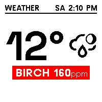

Weather (Glance) 3.5"

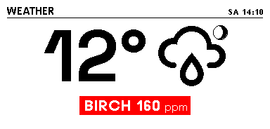


**Single value**

Single value 1.4"

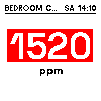

Single value 2.7" landscape

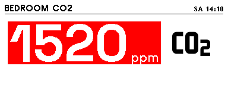

Single value 3.5"

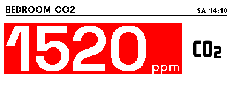


**Weather**

Weather 2.7" landscape

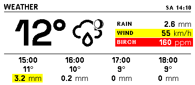

Weather 2.7" portrait

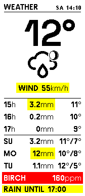

Weather 3.5"

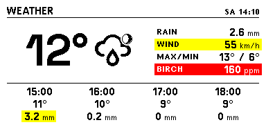

Weather 4.1"

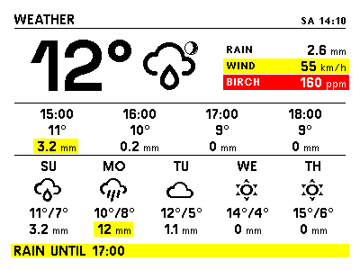

Weather 4.26"

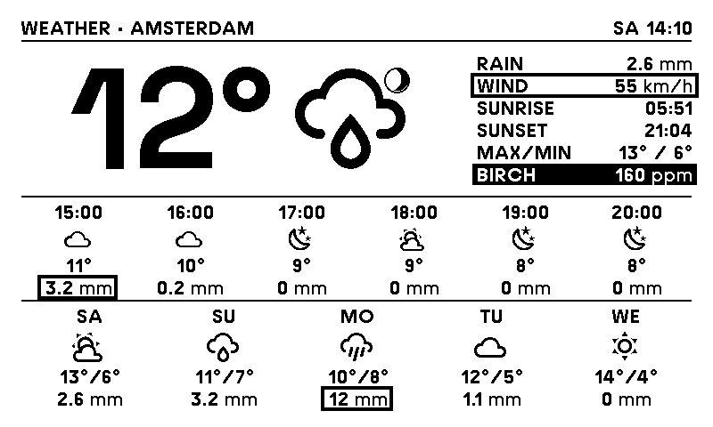

Weather 7.5" landscape

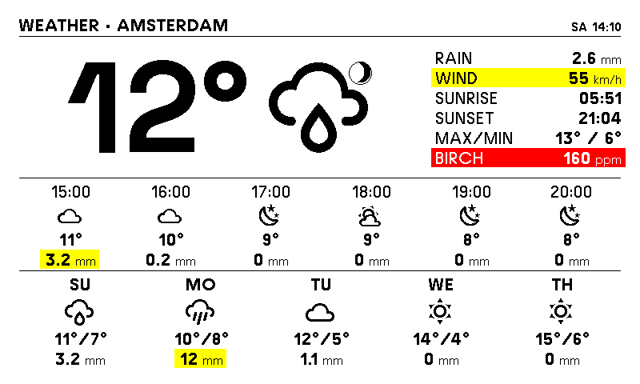

Weather 7.5" portrait

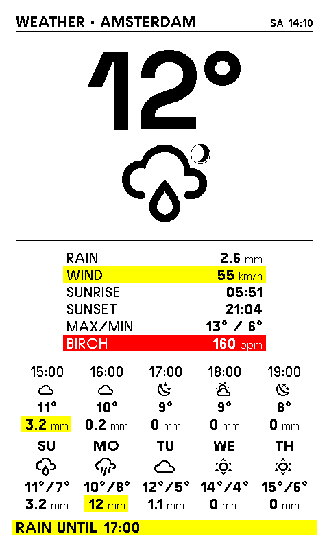


**Medication**

Medication 2.7" landscape

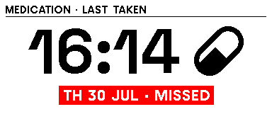


**Doors & windows**

Doors & windows 1.4"

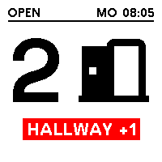


**Rain forecast**

Rain forecast 2.7" landscape

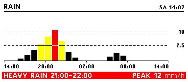

Rain forecast 3.5"

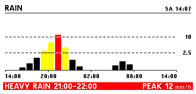


**CO2 graph**

CO2 graph 3.5"

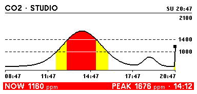


**History graph**

History graph 2.7" landscape

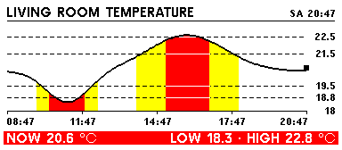

History graph 3.5"

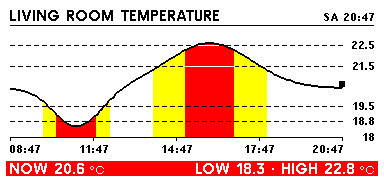

History graph 4.1"

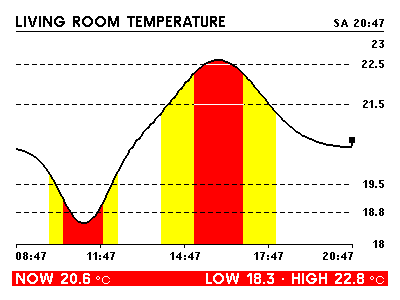


**Sun & moon**

Sun & moon 3.5"

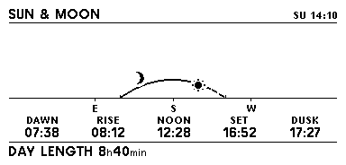


**Claude usage**

Claude usage 3.5"

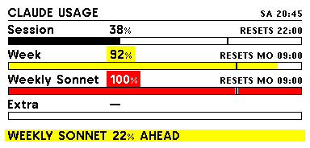


**Levels**

Levels 2.7" landscape

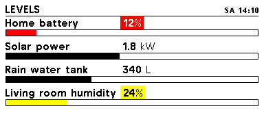

Levels 3.5"

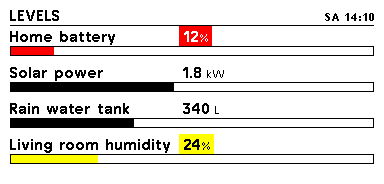

Levels 4.1"

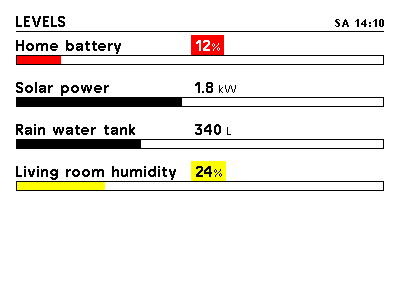


**Entities**

Entities 3.5"

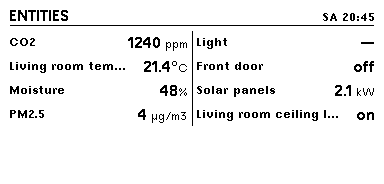


**Plant moisture**

Plant moisture 4.1"

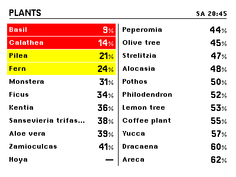


**Weather and calendar**

Weather and calendar 7.5" portrait

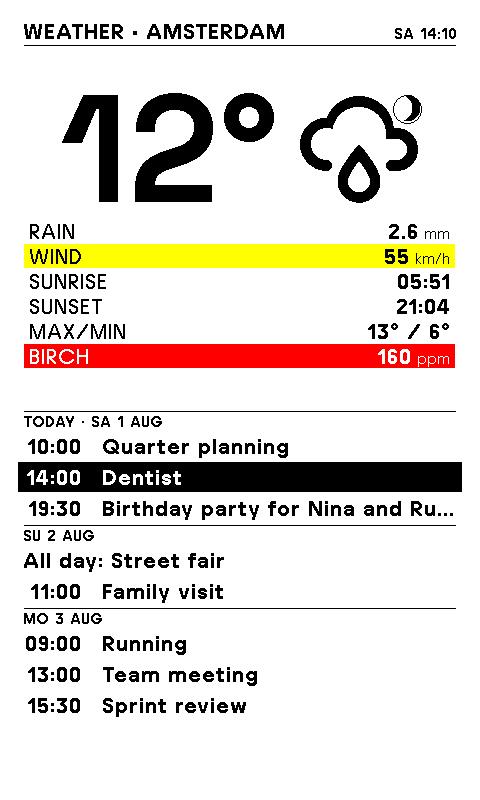


**Calendar**

Calendar 4.1"

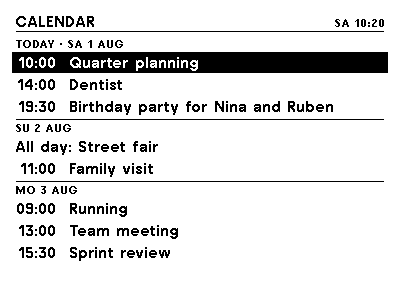

Calendar 4.26"

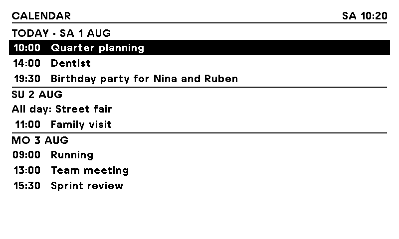


**Next appointment**

Next appointment 3.5"

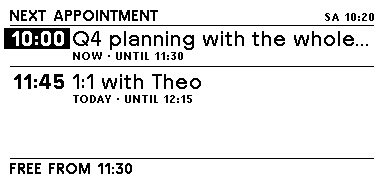

Next appointment 4.1"

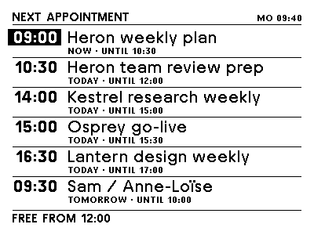

Next appointment 4.26"

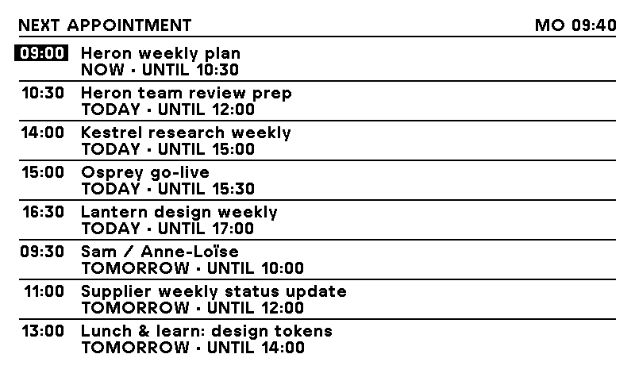


**Tiles**

Tiles 1.4"

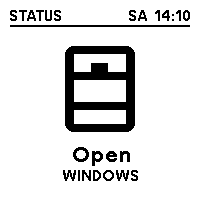

Tiles 2.7" landscape

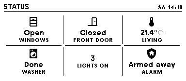

Tiles 2.7" portrait

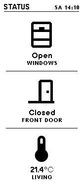

Tiles 3.5"

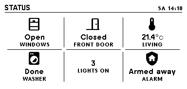

Tiles 4.1"

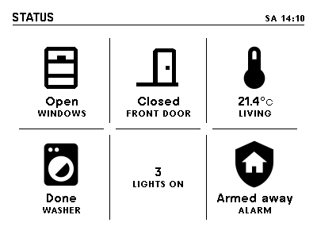

Tiles 7.5" landscape

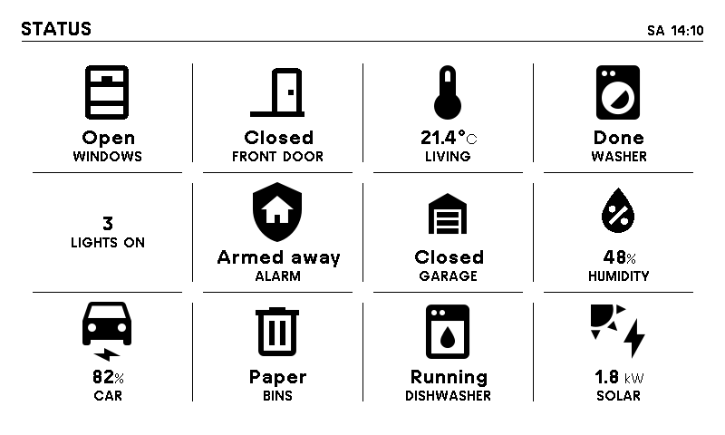

Tiles 7.5" portrait

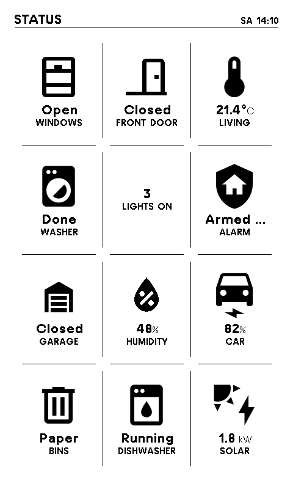
<!-- /registry:pictures -->

The design itself is written down in [docs/design-system.md](docs/design-system.md): screens and their tokens, colour, type, icons, states, components, modules, patterns and pages.

## Install

1. **Templates.** Copy the four files in [`custom_templates/`](custom_templates) (`ep_design.jinja`, `ep_tokens.jinja`, `ep_metrics.jinja`, `ep_i18n.jinja`) into your Home Assistant `config/custom_templates/` folder (create it if needed). Then run **Developer tools > Actions > `homeassistant.reload_custom_templates`**, or restart Home Assistant.
2. **Fonts.** Put these in `/config/www/fonts/` (or another drawcustom font folder): `TRMNL12-Regular.ttf`, `TRMNL12-Bold.ttf`, `TRMNL16-Regular.ttf`, `TRMNL16-Bold.ttf`, `TRMNL21-Regular.ttf` and `TRMNL21-Bold.ttf` from the [TRMNL font bundle](https://trmnl.com/font-family), and `SpaceGrotesk-Bold.ttf` (the static Bold file) from [Google Fonts](https://fonts.google.com/specimen/Space+Grotesk). Both are SIL OFL 1.1. The icons use `materialdesignicons-webfont.ttf` ([Material Design Icons](https://pictogrammers.com/library/mdi/)), which the OpenDisplay integration ships with: nothing to install for it.
3. **Blueprints.** Import the ones you want: open the file on GitHub and use its URL in **Settings > Automations & scenes > Blueprints > Import blueprint**, or copy the files into `config/blueprints/automation/`. Then create an automation from the blueprint.

Each blueprint's description lists what else it needs (a weather, calendar or rain integration, sensors) and how often to redraw it.

A blueprint whose templates are missing fails with `TemplateNotFound: ep_design.jinja` in its trace.

## Updating

Replace the four templates, run `homeassistant.reload_custom_templates`, then re-import the blueprints. Always update the templates and the blueprints together: they are built as one set. A device that shows `UPDATE TEMPLATES AND BLUEPRINT` with two ids has a blueprint and templates from different releases: update whichever is older.

To redraw a device after changing an automation's settings, open the automation and choose **Run actions**. Devices also redraw when Home Assistant starts.

## How it's built

Nothing in `blueprints/` or `custom_templates/` is written by hand. Everything is generated from the sources in [`src/`](src):

| Source | What it holds |
|---|---|
| `src/pages/<page>.yaml` | A page definition: the page's inputs, data, texts, description, and one layout per screen. `src/pages/_shared.yaml` holds what every page shares. |
| `src/specs/<layout>.py` | A spec: what draws one page on one screen (its layout). |
| `src/ds_macros.jinja` | The drawing kit: components, modules and the pattern macros. |
| `src/lib/ep_tokens.jinja` | The tokens per screen (sizes, spacing, type, colours). |
| `src/registry.yaml` | The index of patterns, pages, components, modules and terms; the design system's tables are generated from it. |
| `src/lib/` | The tools: build, generate, check, compare. |
| `src/scen/` | Test scenarios: the states every check case renders. |

To build and check:

```
pip install -r requirements.txt
# put the seven font files above in src/fonts/, plus the icon font from the installed renderer
# (the same file the integration draws with, so the renders match the devices):
cp "$(python3 -c 'import odl_renderer,os;print(os.path.dirname(odl_renderer.__file__))')/assets/materialdesignicons-webfont.ttf" src/fonts/
src/release.sh
```

`release.sh` generates the screen tokens, builds everything twice (the two builds must be identical), runs the lints and the pixel check on every check case, and only then writes `blueprints/` and `custom_templates/`. What each step does, and how a change is proven against reference renders, is in [docs/building.md](docs/building.md). Rendering needs Pillow with Raqm (on macOS: `brew install fribidi` before installing the requirements); the build stops without it, because text would come out wider than the devices draw it.

The renders run in parallel, one process per CPU core; set `EP_JOBS` to use fewer (`EP_JOBS=2 src/release.sh`), for example on a laptop you're working on or a small CI runner. The results are the same whatever the number.

## License and credits

MIT, see [LICENSE](LICENSE). Made by [Guy Sie](https://github.com/guysie), with Claude. Some pages were inspired by other people's blueprints, credited in their descriptions: [Chunkysteveo](https://github.com/chunkysteveo/OpenEPaperLink-HA-Weatherman/) (Weatherman), [davelee98](https://github.com/davelee98/ha-epaper-blueprints) (7.5" weather), [svenove](https://github.com/svenove/OpenEPaperLink-HA-Calendar) (calendar), [sgmobiledev](https://github.com/sgmobiledev/OpenEpaperLinkHATagSources) (sun and moon).
